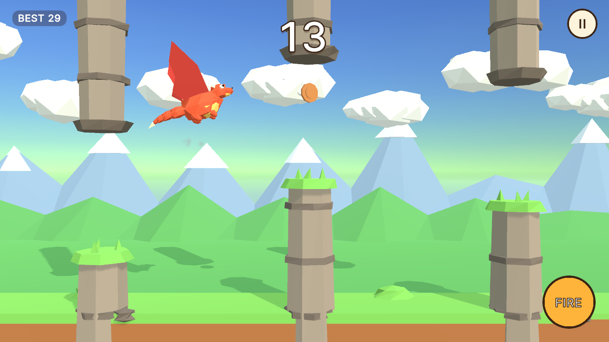
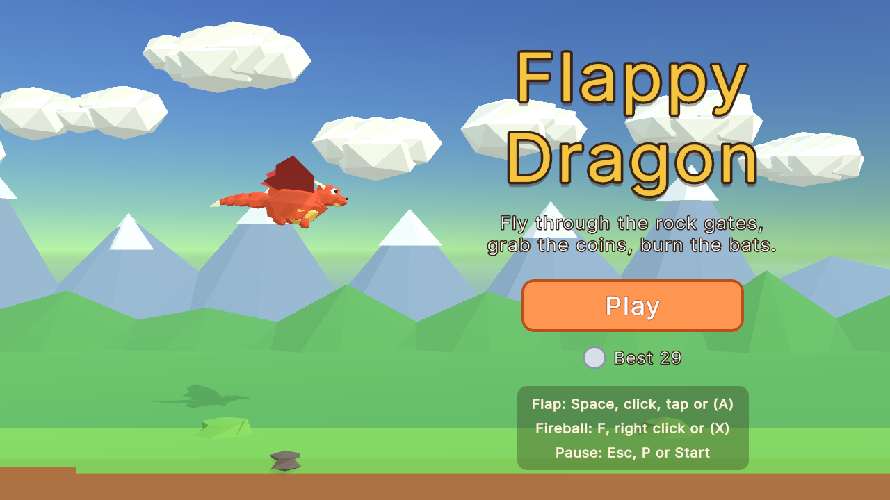
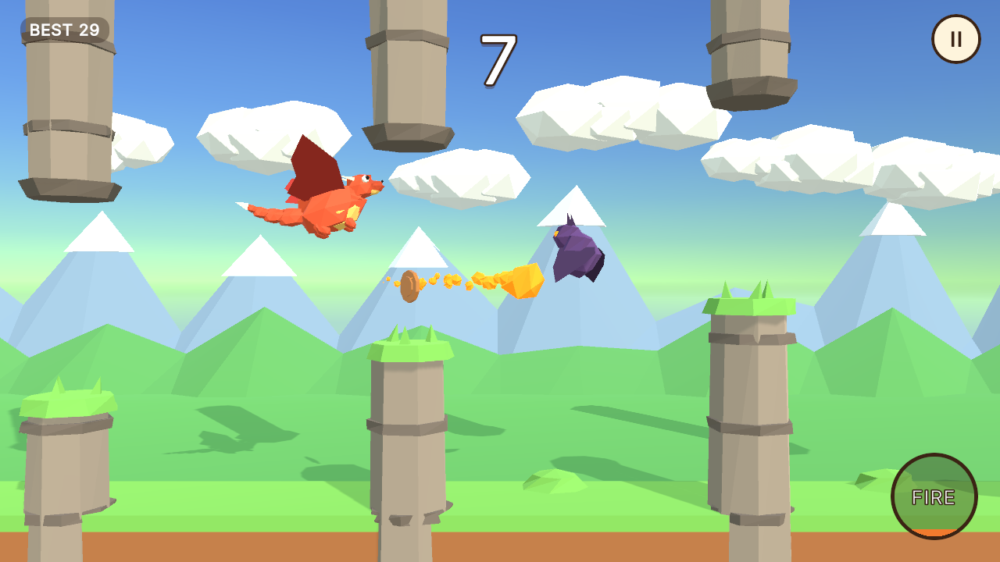
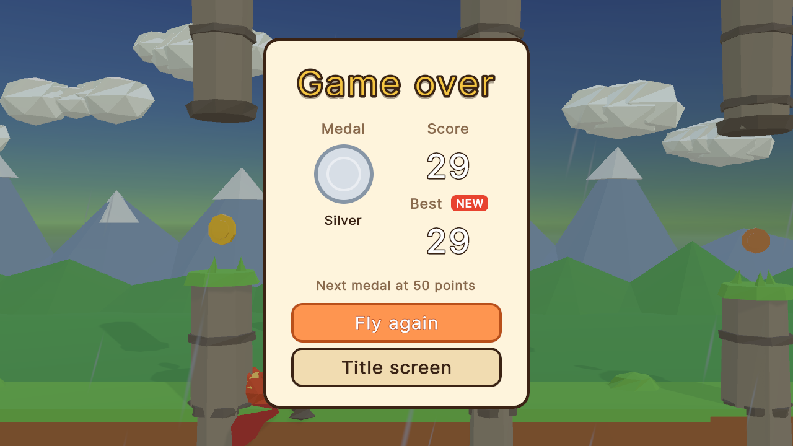

# Flappy Dragon

A low-poly 3D take on Flappy Bird, built with Unity: flap a little dragon through rock gates,
grab coins, burn bats with fireballs and chase medals and your best score as the course speeds up.



| | |
|---|---|
|  |  |
|  | |

## Play it

- **In your browser:** [trysac.github.io/Flappy-Bird-Clone](https://trysac.github.io/Flappy-Bird-Clone/)
- **On itch.io:** [trysac.itch.io/flappy-dragon](https://trysac.itch.io/flappy-dragon)
- **Get the code:** fork this repository, or clone it:

  ```bash
  git clone https://github.com/Trysac/Flappy-Bird-Clone.git
  ```

## Run it

1. Install **Unity 6000.3.27f1 (Unity 6 LTS)** with Unity Hub (add the Windows or Web build
   support module if you want to build players).
2. In Unity Hub choose **Add → Add project from disk** and select the repository folder.
3. Open `Assets/Scenes/Main.unity` and press **Play**.

To build a player use **File → Build Profiles** (Windows or Web), or build from a terminal into
a folder outside the repository:

```bash
Unity -batchmode -quit -projectPath . -executeMethod FlappyDragon.EditorTools.ProjectBuilder.BuildWebGL -buildOutput ../build/web
```

(`BuildWindows` works the same way.) The WebGL build is uncompressed, so it runs from any
static host such as GitHub Pages.

The tests run from **Window → General → Test Runner → EditMode**, or from a terminal:

```bash
Unity -batchmode -projectPath . -runTests -testPlatform EditMode -testResults results.xml
```

## Controls

| Action | Keyboard / mouse | Touch | Gamepad |
|---|---|---|---|
| Flap (and start) | Space, W, Up arrow or left click | Tap anywhere | A / south button |
| Fireball | F, X or right click | FIRE button | X / west button |
| Pause | Esc or P | Pause button | Start |
| Menus | Arrow keys or Tab, then Enter or Space | Tap the buttons | Left stick, then A |

## How it plays

- Every gate you fly through scores a point; coins inside the gates are worth 1 (bronze),
  3 (silver) or 5 (gold), and a bat burnt by a fireball is worth 3.
- Touching a rock, a bat or the ground ends the run. The sky stops your climb but does not hurt.
- The course starts slow with wide gaps and eases towards a faster, tighter cap over the
  first 60 gates. Bats show up after the fifth gate, and rain rolls in from 20 points.
- Medals: bronze at 10 points, silver at 25, gold at 50, platinum at 100. The best score is
  saved on the device (PlayerPrefs).

## What I learned / technically interesting

- **Game rules without the engine.** Flight, difficulty, gate planning, scoring, medals,
  cooldowns and the screen flow live in `Assets/Scripts/Core`, a plain C# assembly with no
  Unity references, covered by 43 EditMode tests. The Unity layer only renders and reads input.
- **A flap that always feels the same.** Instead of adding forces to a Rigidbody, the flap
  sets the upward speed and gravity is integrated by hand, so the response does not depend
  on the current fall speed or the frame rate. Collisions are simple circle-versus-rectangle
  tests on the play plane.
- **Fair random courses.** Each opening is placed inside the sky and never further from the
  previous one than the dragon can climb or dive between gates; a test plans 2,000 gates
  and checks that every opening stays in the sky and within that step limit.
- **Everything is generated.** The dragon, bats, rocks, coins and landscape are flat-shaded
  meshes built in code (`LowPoly.cs`); materials, the scene, the app icon and the player
  settings come from an editor script (`ProjectBuilder.cs`); every sound and the music loop
  come from a tiny Python synthesizer (`tools/audio`). The UI is UI Toolkit (UXML + USS).
- **Rescuing old work.** This started in 2021 as an unfinished Unity 2020 prototype built on
  Asset Store packs, where the dragon could not actually die. It was upgraded to Unity 6, the
  store content (not redistributable in a public repository) was removed, and the game was
  rebuilt around the same idea with original assets.

## Credits

Everything in the game was made for this project: models built in code, generated materials
and icon, synthesized audio, and Unity's default font. See [CREDITS.md](CREDITS.md).

## License

[MIT](LICENSE)
